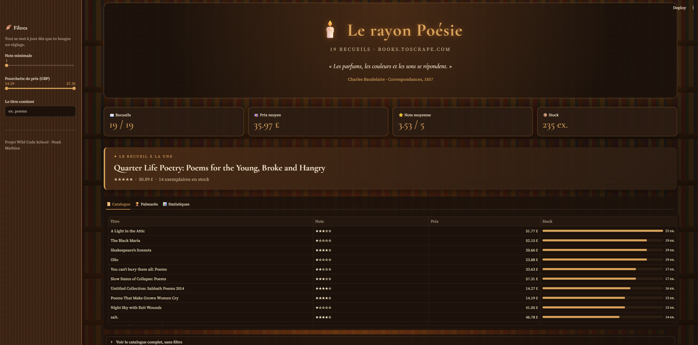

# app-catalogue

👉 [Ouvrir l'application en ligne](https://rayon-poesie.streamlit.app)

Mon premier tableau de bord en Streamlit fait pendant la semaine 9 de ma formation Data Analyst à la Wild Code School.

L'application affiche les 19 livres de poésie du site books.toscrape.com. On filtre à gauche par note, par prix ou par mot du titre. Les chiffres le tableau et les palmarès se mettent à jour tout seuls.



## Ce qu'on y trouve

Quatre chiffres en haut avec le nombre de livres, le prix moyen, la note moyenne et le stock. En dessous il y a le tableau des livres retenus puis les 5 mieux notés et les 5 moins chers. Le catalogue complet est caché dans une section qu'on déplie.

Sans filtre on trouve 19 livres, un prix moyen de 35,97 GBP, une note moyenne de 3,53 et 235 exemplaires en stock.

## Pour la lancer

```bash
python -m venv .venv
source .venv/Scripts/activate
pip install -r requirements.txt
streamlit run app.py
```

Noah Mathieu · [LinkedIn](https://www.linkedin.com/in/noah-mathieu-data)
